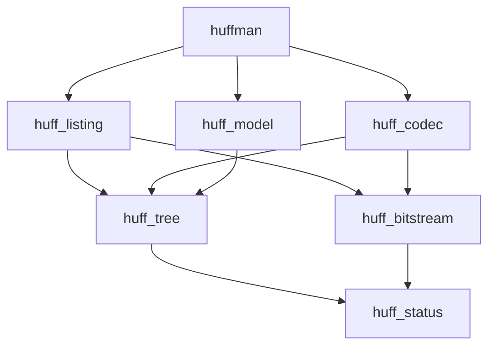

# 实现记录

这里记录已经定下来的决定。函数清单等到讨论对应模块时再补。

## 构建

独立构建目录，源码树里不产生编译产物。C 标准用 C11，关闭编译器扩展。警告打开 `-Wall -Wextra -Wpedantic`。未指定构建类型时用 Debug。生成 `compile_commands.json`，给语言服务用。

每个模块一个静态库，库名以 `huff_` 开头。下层库不链接上层。头文件目录通过 `PUBLIC` 传给依赖它的目标。可执行文件只链接它直接用到的库。

```text
cmake -S . -B build -DCMAKE_BUILD_TYPE=Debug
cmake --build build
ctest --test-dir build --output-on-failure
```

可执行文件是 `build/bin/huffman`。静态库放在 `build/lib/`。测试用 CTest，每个测试只链接它要验证的那几层。

## 命名

类型用 `Huff` 前缀，函数用 `huff_<模块>_<动作>`。头文件放在 `include/huffman/` 下，包含时写成 `#include "huffman/tree.h"` 这种形式。

题目里的 `hfmTree`、`ToBeTran`、`CodeFile`、`TextFile`、`CodePrin`、`TreePrint` 不出现在路径、类型和函数名里。程序读写的路径由调用方传入。下面这些名字是默认路径，菜单里可以直接按回车接受：

| 默认路径 | 内容 |
|---|---|
| `model.huf` | 建好的哈夫曼模型：叶子符号和树 |
| `encoded.huf` | 编码结果，比特按字节紧凑存放 |
| `decoded.bin` | 译码还原出的字节 |
| `codes.txt` | 编码结果的字符清单，每行 50 个 `0` 或 `1` |
| `tree.txt` | 树的字符清单 |

紧凑比特和给人看的 `0`/`1` 分成两个文件。`encoded.huf` 由比特流模块写入。`codes.txt` 和 `tree.txt` 由清单模块写入。

菜单上的操作键仍是 `I`、`E`、`D`、`P`、`T`、`Q`。这是交互入口，不是文件名。

## 目录

```text
Huffman/
├── implementation.md
├── .gitignore
├── CMakeLists.txt
├── include/huffman/
│   ├── status.h
│   ├── tree.h
│   ├── bitstream.h
│   ├── model.h
│   ├── codec.h
│   └── listing.h
├── src/
│   ├── status.c
│   ├── tree.c
│   ├── bitstream.c
│   ├── model.c
│   ├── codec.c
│   ├── listing.c
│   └── main.c
└── tests/
```

`data/` 等放进样本文件时再加。题目附带的文本、图片和视频是输入样本，不作为模块名。

## 模块

| 目标 | 源文件 | 负责 | 不负责 |
|---|---|---|---|
| `huff_status` | `status.c` | 结果码，以及菜单要显示的一句说明 | 建树、读写文件 |
| `huff_tree` | `tree.c` | 内存中的树、由权值建树、由叶子得到码、按比特走回符号 | 打开文件 |
| `huff_bitstream` | `bitstream.c` | 比特的顺序写入和读出，落盘形式是紧凑字节 | 符号和码的对应关系 |
| `huff_model` | `model.c` | 把树写入模型文件，或从模型文件读回内存 | 编码原文 |
| `huff_codec` | `codec.c` | 一次编码或一次译码：读入源字节，经树变成比特；或把比特还原成字节 | 菜单、清单排版 |
| `huff_listing` | `listing.c` | 码清单（每行 50 位）和树清单，同时写到终端和文本文件 | 建树、译码 |
| `huffman` | `main.c` | 菜单，保管当前模型在不在内存里，把路径传给下层 | 结点怎么连、比特怎么排 |

依赖只向下：

- `huff_status` 在最底，不包含本项目的其他头文件。
- `huff_tree` 和 `huff_bitstream` 只使用 `huff_status`。二者互不包含。
- `huff_model` 使用 `huff_tree`。
- `huff_codec` 使用 `huff_tree` 和 `huff_bitstream`。
- `huff_listing` 使用 `huff_tree` 和 `huff_bitstream`。它不包含 `huff_codec.h`。
- `huffman` 调用上面几层。`I` 建树并写入模型文件，同时留在内存。`E` 和 `D` 发现内存里还没有树，就从模型文件读入一次，这次运行的后面不再读。

选作里的「把码压进整数」属于 `huff_bitstream` 的落盘形式，不另开模块。操作时更换源文件和目标文件，只是 `main` 把另一组路径传下去。



## 题目要求落在哪一层

验收时按操作键对照，代码里仍用上一节的名字。

| 操作 | 落点 |
|---|---|
| `I` 初始化 | `huff_tree` 建树，`huff_model` 写入 `model.huf` |
| `E` 编码 | `huff_codec` 读源文件，把比特写入 `encoded.huf` |
| `D` 译码 | `huff_codec` 读 `encoded.huf`，把字节写入 `decoded.bin` |
| `P` 印代码 | `huff_listing` 把比特排成每行 50 个，写入终端和 `codes.txt` |
| `T` 印树 | `huff_listing` 把内存中的树写入终端和 `tree.txt` |
| `Q` 退出 | `main` 结束菜单循环 |

教科书例题和字母频度表从终端读入符号与权值，走 `I`。对任意文件做编码时，符号是字节，权值是该字节在源文件中的出现次数，统计放在后面讨论 `huff_codec` 时再定。

## 进度

目录、`CMakeLists.txt` 和成对的头文件、源文件已经放好。`cmake -S . -B build && cmake --build build` 可以通过，产物是 `build/bin/huffman`。头文件里还没有类型和函数，只有包含保护，以及指向直接下层的 `#include`。这个包含关系就是模块边界。每个 `.c` 包含自己的头文件，并暂时留一个占位 `typedef`，因为打开 `-Wpedantic` 时空翻译单元会告警。真正的函数写进来之后删掉这个占位。

接口按依赖从底向上补：`status`、`tree`、`bitstream`、`model`、`codec`、`listing`，最后是菜单。一个头文件里的声明定下来之后，再写对应的 `.c`。
